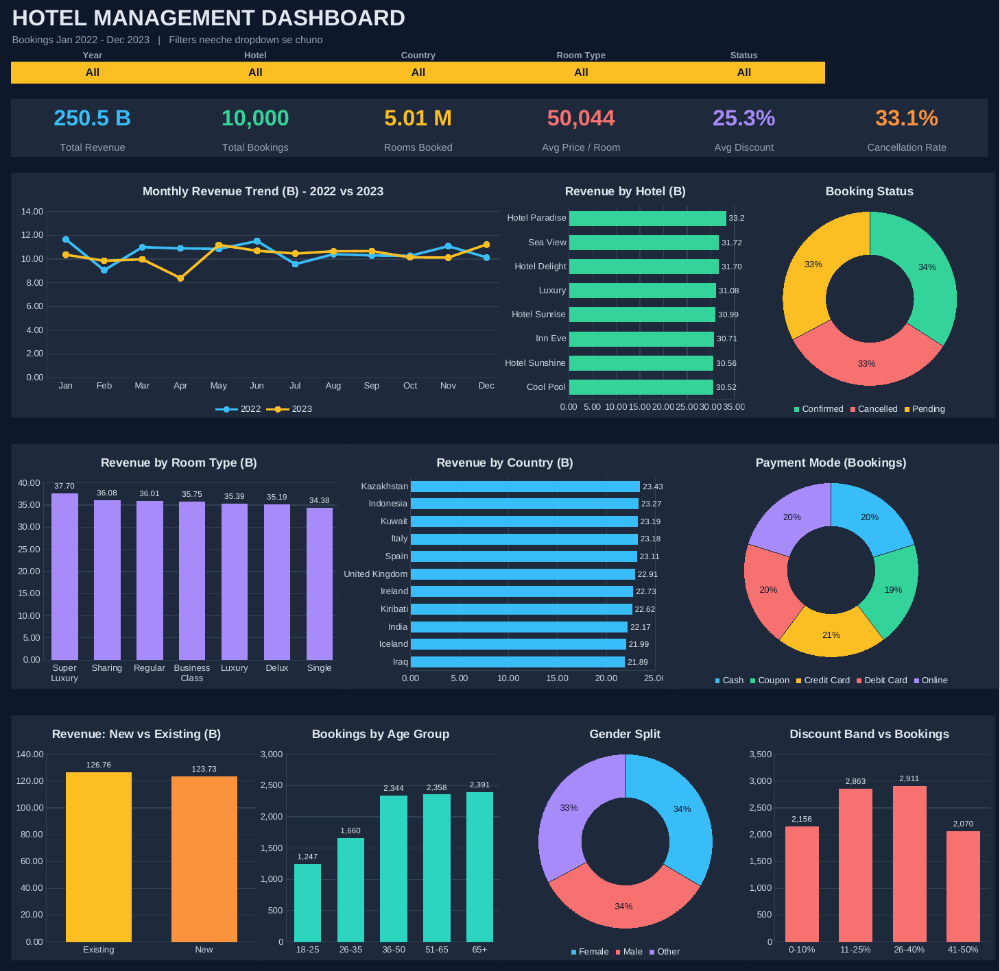

# 🏨 Hotel Management Dashboard

An interactive, filter-driven **Excel dashboard** that analyses 10,000 hotel bookings (Jan 2022 – Dec 2023) across 8 hotels, 11 countries and 7 room types. All KPIs and charts are formula-driven from a single `Data` sheet, so replacing the data refreshes the entire dashboard.



---

## 📌 Key Metrics

| KPI | Value |
|---|---|
| Total Revenue | **250.5 B** |
| Total Bookings | **10,000** |
| Rooms Booked | **5.01 M** |
| Avg. Price / Room | **50,044** |
| Avg. Discount | **25.3 %** |
| Cancellation Rate | **33.1 %** |

## 🔍 Key Insights

- **Revenue is evenly spread** across hotels (12–13 % each); *Hotel Paradise* leads with 33.2 B (13.3 %).
- **Super Luxury** is the top room type (37.7 B, 15 %), while **Single** rooms are lowest (34.4 B).
- **Booking status is balanced:** ~34 % Confirmed, ~33 % Pending, ~33 % Cancelled — roughly one in three bookings is cancelled, a clear revenue-leakage area.
- **Payment modes** are almost equally used; Credit Card is slightly ahead (20.4 %).
- **2022 vs 2023:** revenue is nearly flat (126.7 B vs 123.7 B). Lowest month: Apr 2023; highest: Jan 2022.
- **Customers:** Existing customers generate 50.6 % of revenue vs 49.4 % from new customers.
- **Top countries:** Kazakhstan, Indonesia, Kuwait, Italy, Spain.

## ✨ Features

- 5 dynamic dropdown filters: **Year, Hotel, Country, Room Type, Status**
- 6 KPI cards + 10 charts (trend, hotel, country, room type, payment mode, booking status, customer type, age group, gender, discount band)
- Dark-themed, presentation-ready layout
- Dedicated `Calc` sheet (formulas) and `Lists` sheet (dropdown sources)
- Built-in `ReadMe` sheet with usage instructions

## 📂 Repository Structure

```
hotel-management-dashboard/
├── data/
│   └── Hotel_Management_Dashboard.xlsx   # Dashboard + data + calculations
├── docs/
│   ├── data_dictionary.md                # Column descriptions
│   └── images/
│       └── dashboard-preview.png         # Dashboard screenshot
├── .gitignore
├── LICENSE
└── README.md
```

## 🚀 How to Use

1. Download `data/Hotel_Management_Dashboard.xlsx` and open it in **Microsoft Excel**.
2. Go to the **Dashboard** sheet and choose filters from the dropdowns — all KPIs and charts update instantly.
3. **To use your own data:** open the `Data` sheet, delete the old rows and paste your new data from cell `A2`.
   - Keep the same column names and order (see [data dictionary](docs/data_dictionary.md)).
   - `Booking Date` must be a real date (not text).
   - Formulas are connected up to row **30,000**.

## 🛠️ Tech Stack

- Microsoft Excel (formulas, data validation, charts)

## 📄 License

Released under the [MIT License](LICENSE).

## 👤 Author

**Vishalharel9** — [GitHub](https://github.com/vishalharel9) · [LinkedIn](www.linkedin.com/in/vishal-harel-54aa76324)
